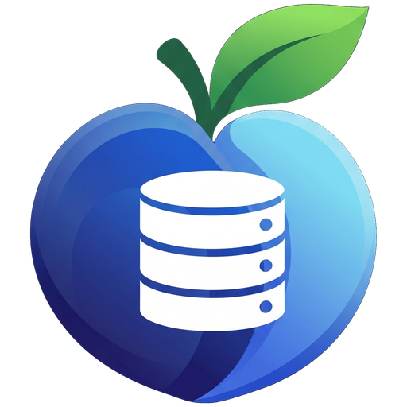
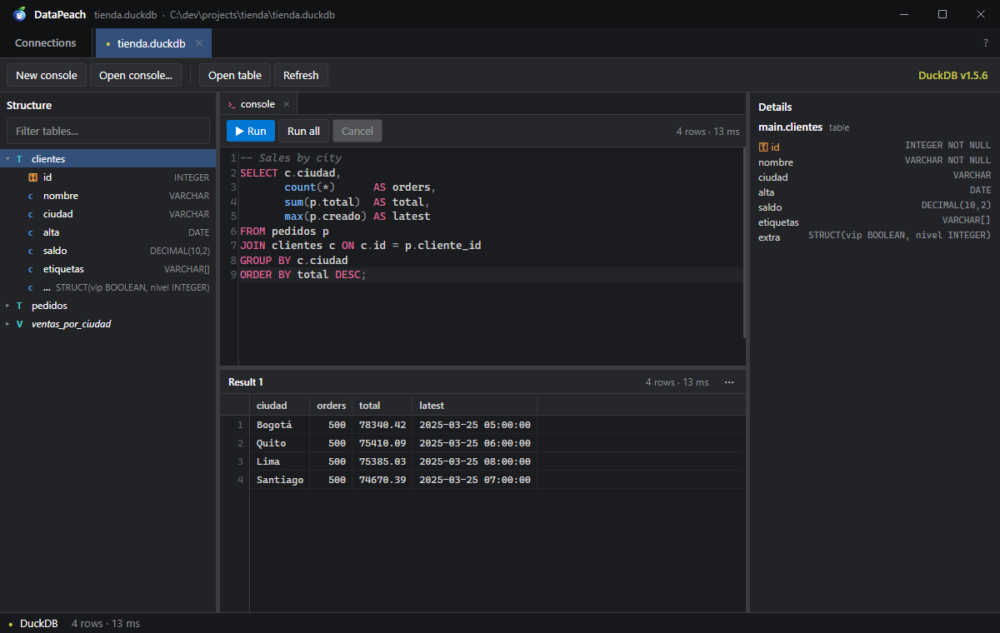
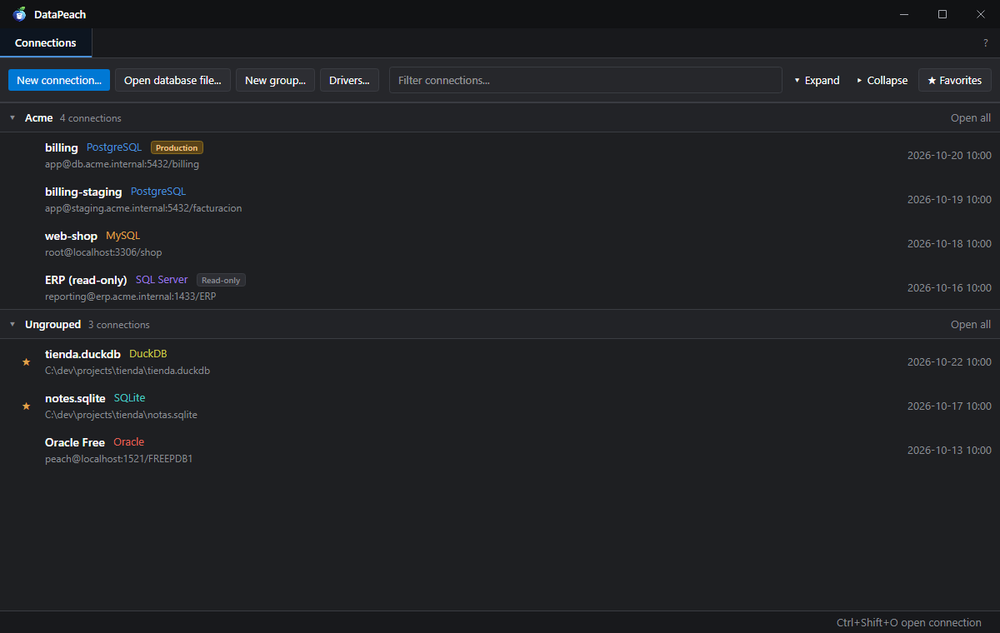
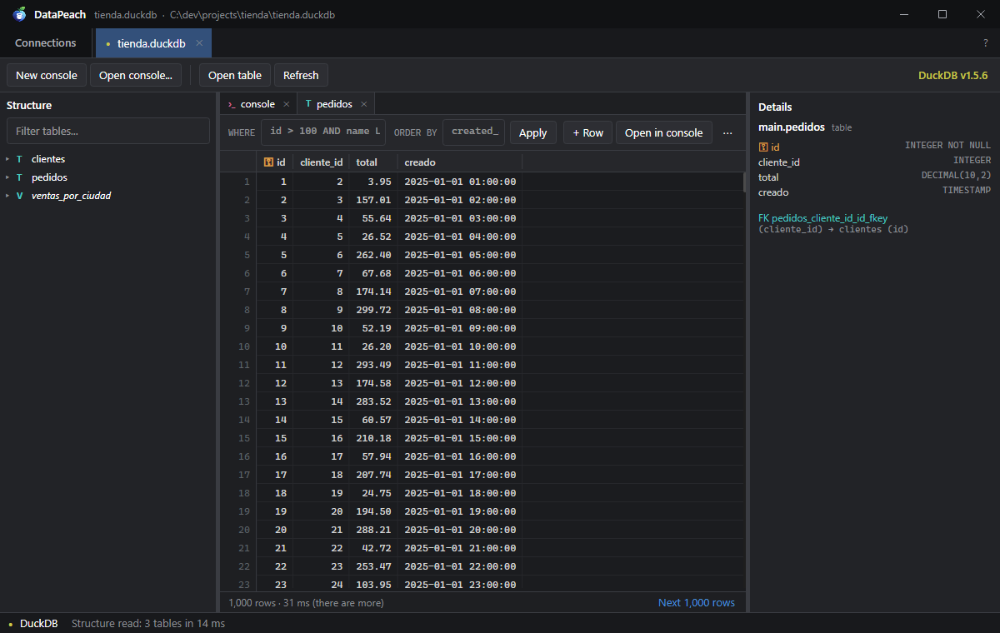
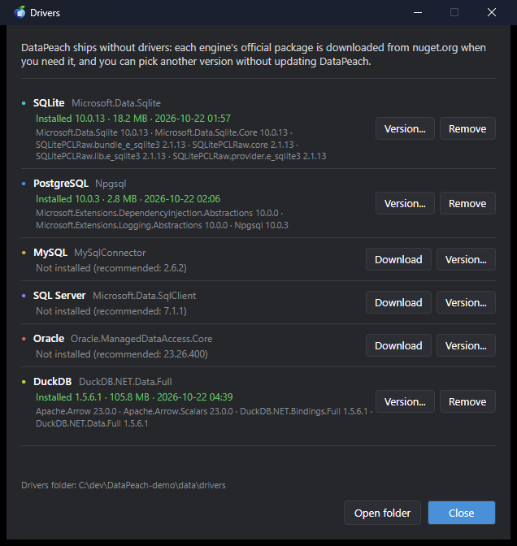
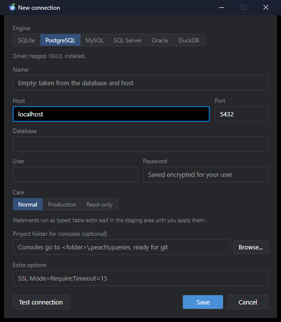
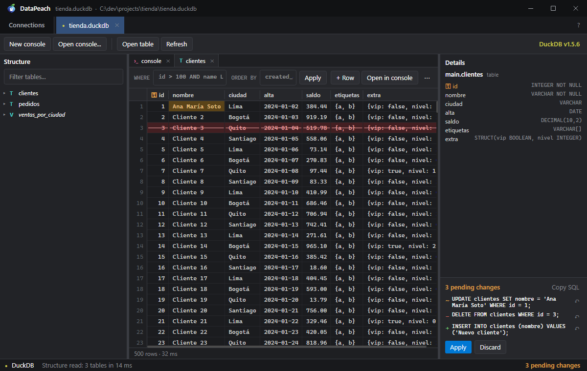
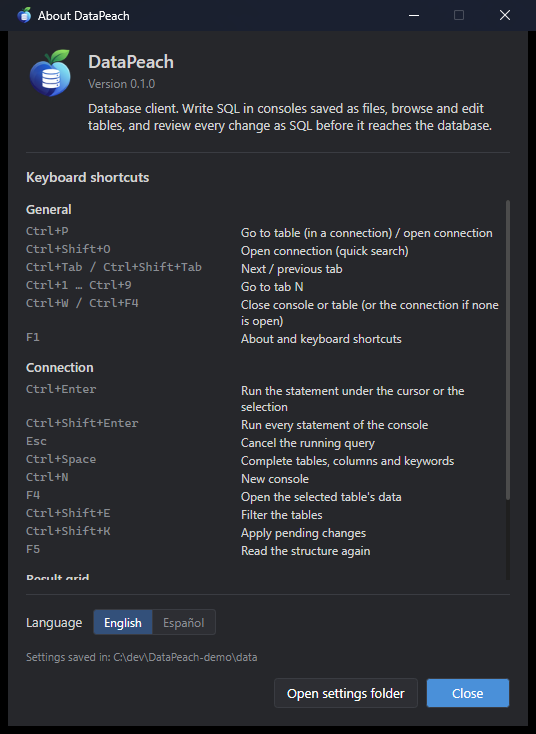

  

<h1 align="center">DataPeach</h1>

  Database client for Windows and Linux, <b>free and open source</b>: fast, light and without accounts. 
  Write SQL in consoles saved as files, browse and edit tables, and review every change as SQL before it reaches the database.

  <a href="README.md">Español</a> · <b>English</b>

  

---

## Screenshots

| | |
|---|---|
|  |  |
| **Connections:** groups, favorites and each one's care mode (production, read-only). | **Tables:** `WHERE` filter, ordering, paging and details with indexes and foreign keys. |
|  |  |
| **Drivers:** downloaded from nuget.org when needed; you pick the version. | **New connection:** engine, care mode and a project folder for the consoles. |

   
  <b>Staging:</b> every edit waits as the exact SQL that will run, until you apply or discard it.

   
  <b>About (F1):</b> version, keyboard shortcuts, language and settings folder.

## Why DataPeach?

Full database clients are heavy (a JVM, hundreds of MB, seconds to open) or paid. DataPeach does the everyday
work with just what it needs:

- **Fast.** Opens in ~240 ms and uses ~30 MB idle. The grid only draws what you see, so 50,000 rows cost the same
  as 50, and the first rows show up while the query is still arriving.
- **Nothing reaches the database unseen.** Editing cells, adding or deleting rows writes nothing: the changes wait
  in a **staging** panel as the exact SQL that will run, and are applied together in one transaction.
- **Care per connection.** Mark a connection as **production** (everything that writes asks first) or
  **read-only** (nothing that writes runs).
- **Deleting can be undone.** Every `DELETE` or `TRUNCATE` asks first with the rows it will remove, keeps them in a
  **delete history** (30 days by default) and gives you the script that puts them back.
- **Stored procedures and functions** on every engine that has them: open their code as a script that recreates
  them, run them with a parameter form (OUT ones included) and script their `DROP`.
- **The whole server, not one database.** Leave the database field empty and the tree shows every database on the
  server (SQL Server, PostgreSQL, MySQL, SAP ASE) like SQL Server's explorer: each one with its schemas and folders of
  tables, views, procedures and functions, and the system ones in a folder apart. Each console picks its database.
- **Consoles are files.** Every console is a `.sql` file saved as you type. Pick a project folder and they go to
  `.peach/queries/`, ready to version and share with git.
- **Drivers on demand.** The exe ships no drivers: each engine's official package is downloaded from nuget.org the
  first time (1–2 MB), and you can switch versions without updating DataPeach.

It belongs to the **Peach** family, with GitPeach and TextPeach: same colors, shortcuts and way of working.

## Engines

| Engine | Driver (downloaded by itself) | Size |
|---|---|---|
| SQLite | Microsoft.Data.Sqlite | ~2 MB |
| PostgreSQL / CockroachDB | Npgsql | ~1.5 MB |
| MySQL / MariaDB | MySqlConnector | ~1 MB |
| SQL Server | Microsoft.Data.SqlClient | ~5 MB |
| Oracle | Oracle.ManagedDataAccess.Core | ~8 MB |
| SAP ASE (Sybase) | AdoNetCore.AseClient | ~0.4 MB |
| DuckDB | DuckDB.NET.Data.Full | ~36 MB (a one-time ~110 MB download) |

All of them are tested against real servers. Redis is planned.

- **SQL Server:** without a user it signs in with your Windows account. A server with a self-signed certificate
  (Docker, development) needs `TrustServerCertificate=True` in the options. Scripts may separate batches with `GO` lines.
- **Oracle:** the database field is the service name (`FREEPDB1`, `ORCLPDB1`…). PL/SQL blocks end with a `/` line,
  as in SQL\*Plus.
- **SAP ASE (Sybase):** port 5000 by default; object owners (`dbo`…) show as schemas. Scripts separate batches with
  `GO`, as in `isql`. It has no read-only session: there only the app stops writes, as with SQL Server.
- **MySQL / MariaDB:** procedure scripts may use `DELIMITER $$`, as in the `mysql` client.
- **DuckDB:** the file opens like a SQLite one (drag it or use *Open file*); the engine is told by the content, not the
  extension. A file written by a DuckDB newer than the driver's will not open until a new DuckDB.NET ships (pick it in
  *Drivers*).

## Delete history

Before a console `DELETE`, DataPeach reads the same rows (same `WHERE`, same transaction) and then saves them in the
settings folder, under `history/`. It backs up `DELETE FROM table [WHERE …]` and `TRUNCATE`; a `DELETE` with `USING`,
`JOIN`, `RETURNING` or a CTE still runs after confirming, but the confirmation says those rows are not kept. Up to
100,000 rows are kept per delete. Staging deletes are always kept. The inverse script is one `INSERT` per row (with
`IDENTITY_INSERT` on SQL Server and SAP ASE when needed), and restoring asks again. How long deletes are kept (7, 30,
90 days or always) is chosen in the history itself, from the **Deletes** button of a connection.

## Getting started

1. **New connection...**: pick the engine, fill in the host or the file and test it (the first time downloads the
   driver).
2. A tab opens with the structure on the left and a console. Write SQL and press `Ctrl+Enter`.
3. Double click (or `F4`) a table to see its rows. Edit a cell by typing over it, review the SQL in the right
   panel and press **Apply**.

## Keyboard

| Shortcut | Action |
|---|---|
| `Ctrl+Enter` / `Ctrl+Shift+Enter` | Run the statement under the cursor (or the selection) / the whole console |
| `Esc` | Cancel the query |
| `Ctrl+Space` | Complete |
| `Ctrl+N` | New console |
| `Ctrl+P` | Go to table |
| `F4` | Open the selected table's data |
| `F5` | Read the structure and the open table again |
| `Ctrl+Shift+K` | Apply pending changes |
| `F1` | Every shortcut and the language |

## Data and privacy

No accounts, no telemetry; the only internet access is downloading drivers from nuget.org when you ask. Everything
lives in `%APPDATA%\peachapps\DataPeach\`: `state.json` (connections, no passwords), `secrets.json` (passwords
encrypted with DPAPI), `drivers\`, `queries\` and `history\` (deleted rows, plain text like the consoles). With a `portable.txt` next to the exe it all goes to `.\data\`.

## Building

You need the .NET 10 SDK: `dev.cmd` (Debug), `dotnet test DataPeach.slnx`, `build.cmd [x.y.z]` (portable exe in
`dist\`). To test against real servers: `docker compose -f tests/docker/compose.yml up -d --wait`, then run the tests
with `DATAPEACH_ENGINE_TESTS=1`. Architecture: [docs/ARQUITECTURA.md](docs/ARQUITECTURA.md) · design: [docs/DISENO.md](docs/DISENO.md)
(Spanish). Contributing: [CONTRIBUTING.md](CONTRIBUTING.md).

## License

[GPL-3.0-or-later](LICENSE).
