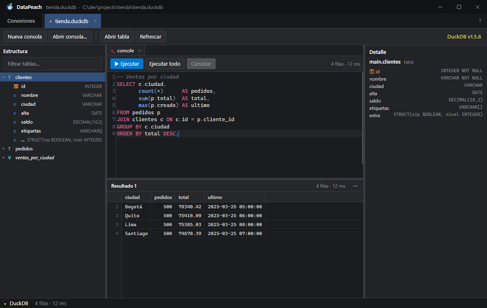
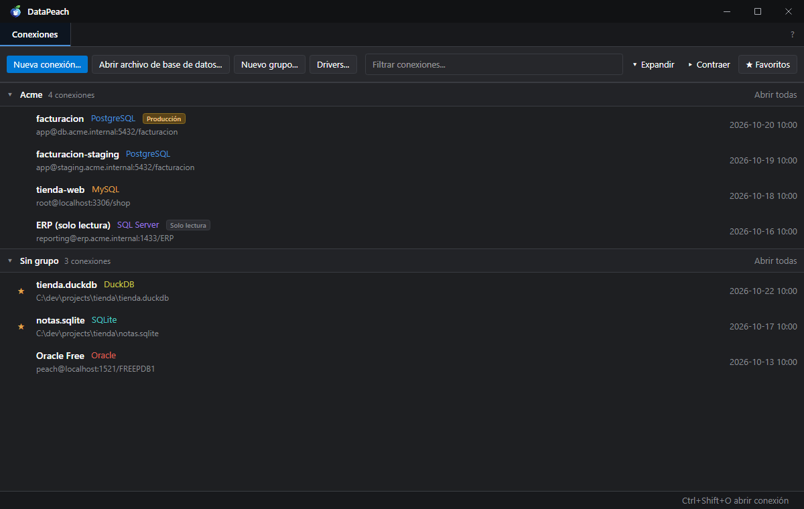
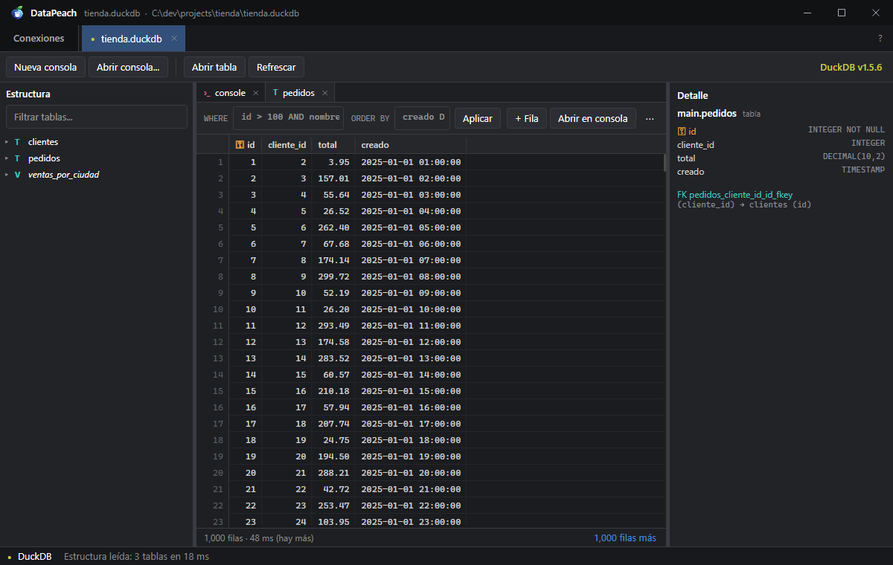
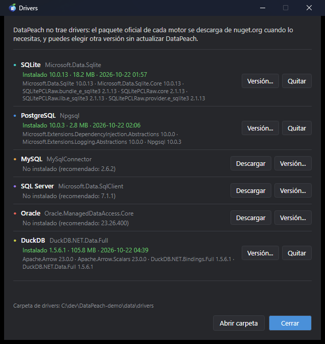
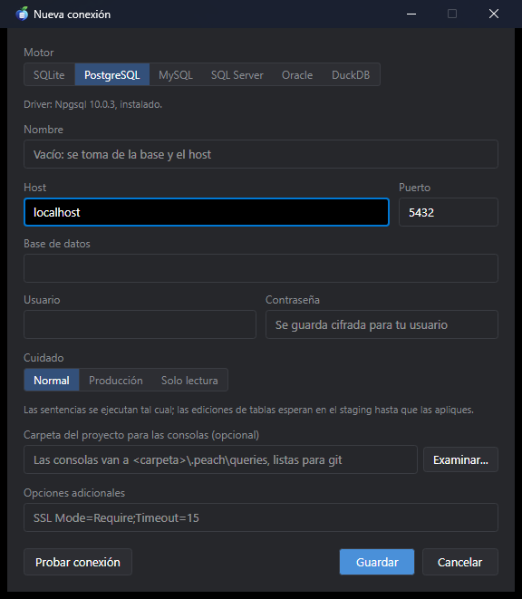
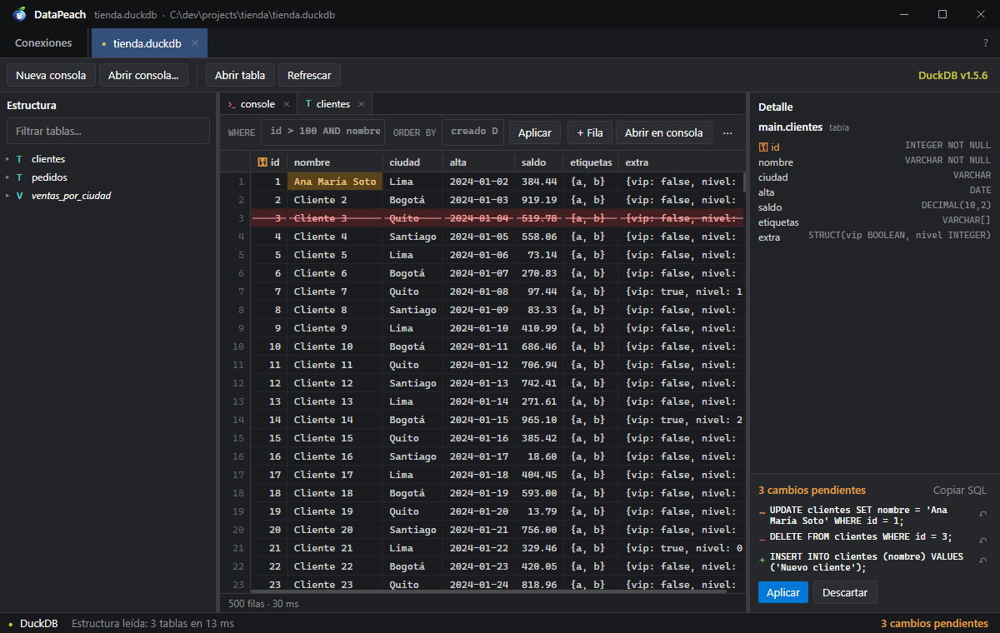
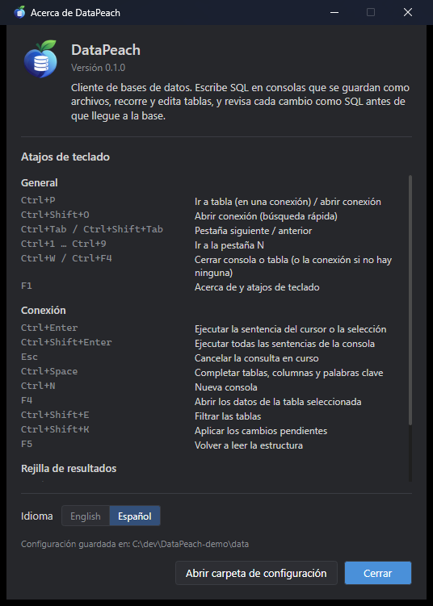

<p align="center">
  
</p>

<h1 align="center">DataPeach</h1>

<p align="center">
  Cliente de bases de datos para Windows y Linux, <b>gratis y open source</b>: rápido, liviano y sin cuentas.<br/>
  Escribe SQL en consolas que se guardan como archivos, recorre y edita tablas, y revisa cada cambio como SQL antes de que llegue a la base.
</p>

<p align="center">
  <b>Español</b> · <a href="README.en.md">English</a>
</p>

<p align="center">
  
</p>

---

## Índice

- [¿Por qué DataPeach?](#por-qué-datapeach)
- [Capturas](#capturas)
- [Características](#características)
- [Motores](#motores)
- [Requisitos e instalación](#requisitos-e-instalación)
- [Primeros pasos](#primeros-pasos)
- [Cómo funciona](#cómo-funciona)
- [Atajos de teclado](#atajos-de-teclado)
- [Datos, privacidad y modo portable](#datos-privacidad-y-modo-portable)
- [Límites conocidos](#límites-conocidos)
- [Compilar desde el código](#compilar-desde-el-código)
- [Contribuir](#contribuir)
- [Licencia](#licencia)

---

## ¿Por qué DataPeach?

Los clientes de bases de datos completos son pesados (una JVM, cientos de MB, segundos para abrir) o de pago.
DataPeach hace lo que se usa todos los días con lo justo:

- **Rápido.** Abre en ~240 ms y usa ~30 MB en reposo. La rejilla dibuja solo lo que ves, así que 50.000 filas
  cuestan lo mismo que 50, y las primeras filas aparecen mientras la consulta sigue llegando.
- **Nada llega a la base sin verse antes.** Editar celdas, agregar o borrar filas no escribe nada: los cambios
  esperan en un panel de **staging** como el SQL exacto que se va a ejecutar, y se aplican juntos en una
  transacción.
- **Cuidado por conexión.** Marca una conexión como **producción** (todo lo que escribe pide confirmación) o
  **solo lectura** (no se ejecuta nada que escriba).
- **Borrar tiene vuelta atrás.** Cada `DELETE` o `TRUNCATE` pide confirmación con las filas que va a quitar, las
  guarda en un **historial de borrados** (30 días por defecto) y te da el script que las devuelve.
- **Todo el servidor, no una base.** Deja vacío el campo base de datos y el árbol muestra todas las del servidor
  (SQL Server, PostgreSQL, MySQL, SAP ASE) como el explorador de SQL Server: cada base con sus esquemas y carpetas
  de tablas, vistas, procedimientos y funciones, y las de sistema en una carpeta aparte. Cada consola elige su base.
- **Consolas como archivos.** Cada consola es un `.sql` que se guarda solo. Elige una carpeta de proyecto y van a
  `.peach/queries/`, listas para versionar y compartir con git.
- **Drivers a demanda.** El exe no trae drivers: el paquete oficial de cada motor se descarga de nuget.org la
  primera vez (1–2 MB) y puedes cambiar de versión sin actualizar DataPeach.

Es parte de la familia **Peach**, junto a GitPeach y TextPeach: mismos
colores, atajos y forma de trabajar.

## Capturas

| | |
|---|---|
|  |  |
| **Conexiones:** grupos, favoritos y el cuidado de cada una (producción, solo lectura). | **Tablas:** filtro `WHERE`, orden, paginado y detalle con índices y claves foráneas. |
|  |  |
| **Drivers:** se descargan de nuget.org cuando hacen falta; eliges la versión. | **Nueva conexión:** motor, cuidado y carpeta de proyecto para las consolas. |

<p align="center">
  <br/>
  <sub><b>Staging:</b> cada edición espera como el SQL exacto que se va a ejecutar, hasta que la aplicas o descartas.</sub>
</p>

<p align="center">
  <br/>
  <sub><b>Acerca de (F1):</b> versión, atajos de teclado, idioma y carpeta de configuración.</sub>
</p>

## Características

- Home de conexiones con grupos, favoritos, filtro y búsqueda rápida (`Ctrl+Shift+O`).
- Arrastra un archivo `.db` / `.sqlite` a la ventana y se abre al instante.
- Árbol de estructura como el explorador de SQL Server: todas las bases de datos del servidor (las de sistema en
  una carpeta aparte, cada una leída al abrirla), esquemas y carpetas de tablas, vistas, procedimientos y
  funciones, con filtro, y panel de detalle con índices, claves foráneas y parámetros. Cada consola elige en qué
  base corre.
- Procedimientos almacenados y funciones en todos los motores que los tienen: abrir su código como un script que
  los recrea, ejecutarlos con un formulario de parámetros (incluidos los de salida) y generar su `DROP`.
- Historial de borrados por conexión, con el SQL que se ejecutó, las filas que quitó y su script inverso:
  restaurar (en una transacción y con confirmación), abrirlo en una consola para ajustarlo o copiarlo.
- Consolas SQL con colores, autocompletado de tablas, columnas y alias, `Ctrl+Enter` para la sentencia del
  cursor, varios resultados por ejecución y cancelación con `Esc`.
- Datos de una tabla con filtros `WHERE` y `ORDER BY`, de a 1.000 filas.
- Edición en la rejilla con staging: celdas editadas en ámbar, filas nuevas en verde, filas a borrar en rojo, y
  el SQL de cada cambio con su botón para deshacerlo.
- Copiar y exportar a CSV, TSV, JSON, tabla Markdown, sentencias INSERT e interfaces TypeScript.
- Contraseñas cifradas para tu usuario de Windows (DPAPI), nunca en texto plano.
- Interfaz en español e inglés.

## Motores

| Motor | Driver (se descarga solo) | Tamaño |
|---|---|---|
| SQLite | Microsoft.Data.Sqlite | ~2 MB |
| PostgreSQL / CockroachDB | Npgsql | ~1,5 MB |
| MySQL / MariaDB | MySqlConnector | ~1 MB |
| SQL Server | Microsoft.Data.SqlClient | ~5 MB |
| Oracle | Oracle.ManagedDataAccess.Core | ~8 MB |
| SAP ASE (Sybase) | AdoNetCore.AseClient | ~0,4 MB |
| DuckDB | DuckDB.NET.Data.Full | ~36 MB (se descargan ~110 MB una vez) |

Todos están probados contra servidores reales (ver [Probar contra servidores reales](#probar-contra-servidores-reales)).
Redis está planeado.

- **SQL Server:** sin usuario entra con tu cuenta de Windows. Un servidor con certificado propio (Docker, desarrollo)
  necesita `TrustServerCertificate=True` en las opciones. Los scripts pueden separar lotes con líneas `GO`.
- **Oracle:** el campo base de datos es el nombre del servicio (`FREEPDB1`, `ORCLPDB1`…). Los bloques PL/SQL terminan
  con una línea `/`, como en SQL\*Plus.
- **SAP ASE (Sybase):** puerto 5000 por defecto; los dueños de los objetos (`dbo`…) se muestran como esquemas. Los
  scripts separan lotes con `GO`, como en `isql`. No tiene sesión de solo lectura: ahí solo frena la app, como en
  SQL Server.
- **MySQL / MariaDB:** los scripts de procedimientos pueden usar `DELIMITER $$`, como en el cliente `mysql`.
- **DuckDB:** el archivo se abre como uno de SQLite (arrastrándolo o con *Abrir archivo*); el motor se reconoce por el
  contenido, no por la extensión. Un archivo creado con un DuckDB más nuevo que el del driver no abre hasta que salga
  una versión nueva de DuckDB.NET (se elige en *Drivers*).

## Requisitos e instalación

Windows 10/11 x64 o Linux x64. No hace falta instalar .NET ni nada más (en Linux, solo `libicu`, que traen casi
todas las distribuciones de escritorio).

Descarga lo que prefieras desde la sección *Releases* del repositorio (o compílalo, ver
[Compilar desde el código](#compilar-desde-el-código)):

- **Windows, con instalador:** `datapeach-windows-x64-setup.exe`. Se instala solo para tu usuario (no pide administrador)
  en `%LOCALAPPDATA%\Programs\DataPeach`, aparece al buscar en el menú Inicio y se desinstala desde
  **Configuración > Aplicaciones**.
- **Windows, portable:** `datapeach-windows-x64-portable.exe`. Ponlo en la carpeta que quieras y ejecútalo.
- **Linux:** `datapeach-linux-x64.tar.gz`. Descomprímelo con `tar -xzf datapeach-linux-x64.tar.gz` y
  ejecuta `./DataPeach`, o `./install.sh` para instalarlo en tu usuario (sin root): queda en
  `~/.local/opt/datapeach`, con el comando `datapeach` y una entrada en el menú de aplicaciones. Para quitarlo,
  `~/.local/opt/datapeach/uninstall.sh`.

*(Opcional)* **Modo portable:** crea un archivo vacío `portable.txt` junto al exe y los datos se guardarán
en `.\data\` a su lado en lugar de en tu perfil. Desinstalar nunca borra tus datos.

### Actualizaciones

Una vez al día, al abrirse, DataPeach mira en GitHub si hay una versión nueva. Si la hay, aparece un botón
**↑ 1.2.0** junto al **?**; nada más cambia. Al pulsarlo ves las novedades y eliges **Actualizar y reiniciar**,
**Ahora no** u **Omitir esta versión**. Al actualizar, la descarga se verifica con su SHA-256, DataPeach se
reinicia y vuelve a abrir tus conexiones. Si lo instalaste con el instalador, se actualiza ejecutando el nuevo
instalador en silencio. En **Acerca de** (F1) puedes desactivar la búsqueda automática o buscar en el momento.

## Primeros pasos

1. **Nueva conexión...**: elige el motor, completa el host o el archivo y prueba la conexión (la primera vez
   descarga el driver).
2. Se abre una pestaña con la estructura a la izquierda y una consola. Escribe SQL y pulsa `Ctrl+Enter`.
3. Doble clic (o `F4`) en una tabla para ver sus datos. Edita una celda escribiendo encima, revisa el SQL en el
   panel de la derecha y pulsa **Aplicar**.

## Cómo funciona

- **Staging.** Varias ediciones de una fila se juntan en un `UPDATE`; las filas se identifican por su clave
  primaria, por eso una tabla sin clave primaria no se edita. Aplicar ejecuta todo en una transacción: si algo
  falla (una clave foránea, una fila que otro borró), no se aplica nada y los cambios siguen pendientes.
- **Producción y solo lectura.** Qué sentencias "escriben" se decide de forma conservadora: lo que no se
  reconoce como lectura cuenta como escritura. En solo lectura la sesión además se abre en modo lectura cuando el
  motor lo permite.
- **Historial de borrados.** Antes de un `DELETE` de la consola, DataPeach lee las mismas filas (con el mismo
  `WHERE`, en la misma transacción) y después las guarda en la carpeta de configuración, en `history/`. Respalda
  `DELETE FROM tabla [WHERE …]` y `TRUNCATE`; un `DELETE` con `USING`, `JOIN`, `RETURNING` o un CTE se ejecuta igual
  tras confirmar, pero la confirmación avisa que esas filas no se guardan. Se respaldan hasta 100.000 filas por
  borrado. Los borrados del staging se guardan siempre. El script inverso son `INSERT` fila por fila (con
  `IDENTITY_INSERT` en SQL Server y SAP ASE cuando hace falta) y restaurar vuelve a pedir confirmación. Cuánto
  tiempo se guardan (7, 30, 90 días o siempre) se elige en el mismo historial.
- **Drivers.** Desde **Drivers...** ves qué hay instalado, actualizas, eliges otra versión de nuget.org o quitas
  uno. Cada driver se carga aislado del resto.

Los detalles están en [docs/ARQUITECTURA.md](docs/ARQUITECTURA.md) y el diseño en [docs/DISENO.md](docs/DISENO.md).

## Atajos de teclado

| Atajo | Acción |
|---|---|
| `Ctrl+Enter` / `Ctrl+Shift+Enter` | Ejecutar la sentencia del cursor (o la selección) / toda la consola |
| `Esc` | Cancelar la consulta |
| `Ctrl+Space` | Autocompletar |
| `Ctrl+N` | Nueva consola |
| `Ctrl+P` | Ir a tabla |
| `F4` | Abrir los datos de la tabla seleccionada |
| `F5` | Volver a leer la estructura y la tabla abierta |
| `Ctrl+Shift+K` | Aplicar los cambios pendientes |
| `F2` · `Ctrl+C` · `Ctrl+Shift+C` | Editar celda · copiar · copiar con encabezados |
| `F1` | Todos los atajos e idioma |

## Datos, privacidad y modo portable

DataPeach no tiene cuentas ni telemetría. Solo se conecta a internet para descargar drivers de nuget.org cuando
se lo pides y para preguntar a la API pública de GitHub por su último release, como mucho una vez al día
(desactivable en **Acerca de**); la versión nueva solo se descarga si tú lo pides. Todo se guarda en `%APPDATA%\peachapps\DataPeach\` (en Linux, `~/.config/peachapps/DataPeach/`):
`state.json` (conexiones, sin contraseñas), `secrets.json` (contraseñas cifradas), `drivers\`, `queries\` e
`history\` (las filas borradas, en texto plano como las consolas).
Con un archivo `portable.txt` junto al exe, todo eso queda en `.\data\`.

## Límites conocidos

- Hasta 50.000 filas por resultado de consola (se indica "(limitado)").
- Una tabla sin clave primaria se ve pero no se edita.
- Sin túneles SSH, ERD ni plan de ejecución visual todavía.
- SQL Server, Oracle y SAP ASE no tienen sesión de solo lectura: ahí el modo *Solo lectura* lo impone la app, no el
  servidor.
- El historial de borrados respalda `DELETE` sobre una tabla (con o sin `WHERE`) y `TRUNCATE`, hasta 100.000 filas;
  `DROP TABLE` no se respalda. Restaurar inserta las filas tal cual: columnas `GENERATED ALWAYS` (PostgreSQL,
  Oracle) necesitan ajustar el script en la consola.
- En Oracle, los parámetros OUT de un procedimiento quedan en variables del bloque generado (DataPeach no muestra
  `DBMS_OUTPUT`).
- Las pruebas contra servidores reales corren en local con Docker, todavía no en CI.

## Compilar desde el código

Necesitas el SDK de .NET 10.

```
dev.cmd                     compila en Debug y ejecuta
dotnet test DataPeach.slnx  tests
build.cmd [x.y.z]           dist\DataPeach.exe portable (build.sh en Linux)
```

### Probar contra servidores reales

`tests/docker/compose.yml` levanta PostgreSQL, MySQL, MariaDB, SQL Server, Oracle y CockroachDB en puertos que no
chocan con los de un servidor instalado. Las mismas pruebas (estructura, streaming, cancelar, staging, solo lectura)
corren contra cada uno; DuckDB no necesita servidor.

```
docker compose -f tests/docker/compose.yml up -d --wait
set DATAPEACH_ENGINE_TESTS=1
dotnet test DataPeach.slnx
```

## Contribuir

Lee [CONTRIBUTING.md](CONTRIBUTING.md): ramas `feature/`, `fix/`, `docs/`…, un PR por cambio, textos en
`src/DataPeach.Core/Strings.cs` en los dos idiomas y tests para la lógica nueva.

## Licencia

[GPL-3.0-or-later](LICENSE).
